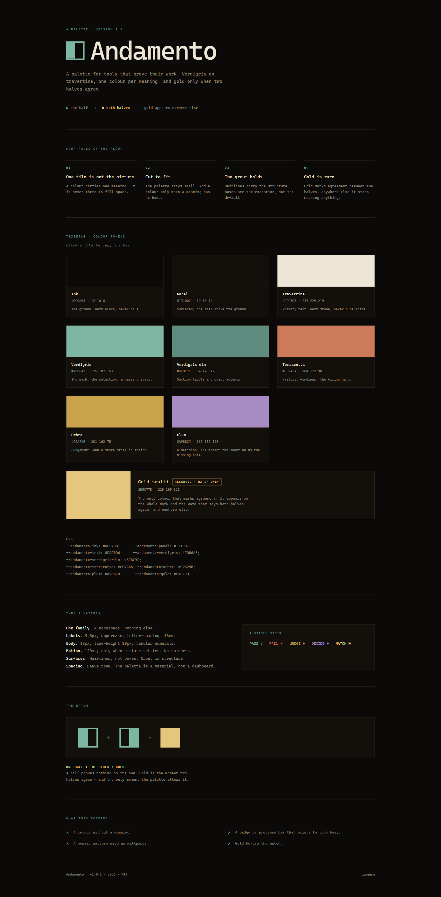

# Andamento

A nine-tessera palette: verdigris on travertine, one colour per meaning, and gold only
when two halves agree.

**[View the palette](https://stfade.github.io/andamento/)**



## Tokens

| token | value | role |
|---|---|---|
| ink | `#0C0A08` | ground |
| panel | `#13100C` | surfaces |
| text | `#EDE5D6` | travertine, primary text |
| verdigris | `#7DB6A3` | mark, selection, pass |
| verdigris dim | `#5E8C7E` | section labels |
| terracotta | `#CC7A5A` | failure |
| ochre | `#C9A24B` | judgement, running |
| plum | `#A98BC4` | decision |
| **gold smalti** | `#E4C77D` | **matched, reserved** |

## Use

```css
@import "andamento.css";
```

Or take the values from `andamento.tokens.json`. No dependencies, no build.

```html
<link rel="stylesheet" href="andamento.css">
```

## Four rules

1. **One tile is not the picture.** A colour carries one meaning; it is never there to
   fill space.
2. **Cut to fit.** The palette stays small. Add a colour only when a meaning has no home.
3. **The grout holds.** Hairlines carry the structure. Boxes are the exception.
4. **Gold is rare.** It marks agreement between two halves. Anywhere else it stops
   meaning anything.

## The mark

`◧` one half; `■` when both halves agree, in gold. The palette reserves that
single moment.

## License

MIT - see [LICENSE](LICENSE).

Andamento, v0.1.0, 2026.
